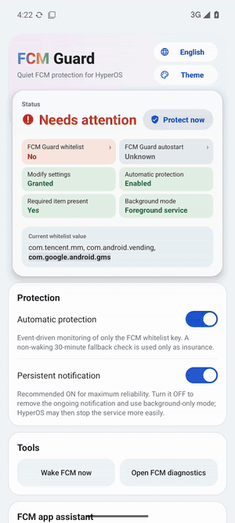
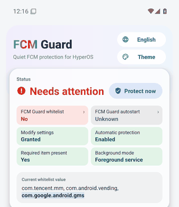
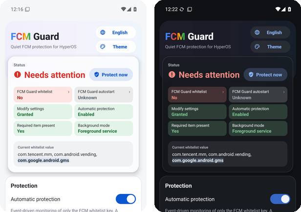
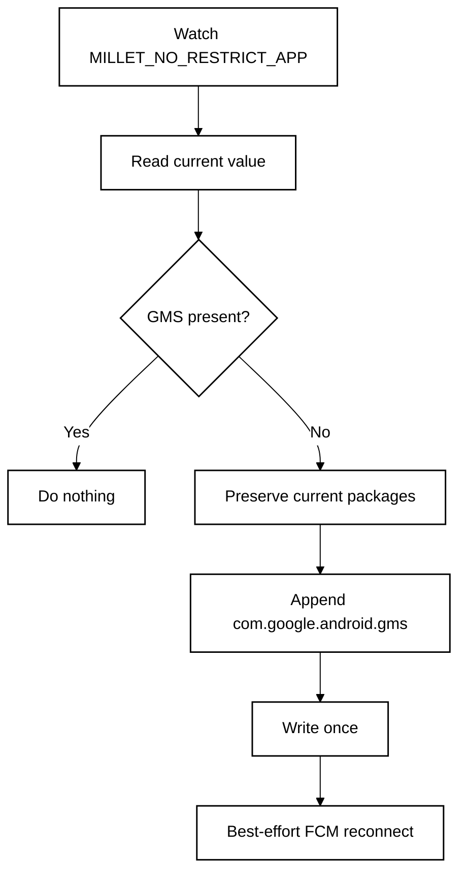

<p align="center">
  <a href="README.md"><strong>English</strong></a> · <a href="README.zh-CN.md">简体中文</a>
</p>

<p align="center">
  
</p>

# FCM Guard for HyperOS

**A lightweight, no-root watchdog for HyperOS 3 China ROM that keeps Google Play services in Xiaomi's no-restrict background list so FCM push stays reliable.**

**Designed for:** China-market Xiaomi / Redmi / POCO phones with Google Play services already installed and working.

<p align="center">
  <a href="https://github.com/ReedGAOOO/FCMGuard-HyperOS/releases/latest/download/FCMGuard-HyperOS.apk"><strong>Download latest APK</strong></a>
  ·
  <a href="https://github.com/ReedGAOOO/FCMGuard-HyperOS/releases/latest">Latest release</a>
</p>

## What's new in 2.0

<table>
  <tr>
    <td align="center" width="33%"></td>
    <td align="center" width="33%"></td>
    <td align="center" width="33%"></td>
  </tr>
  <tr>
    <td valign="top"><b>9 themes, live preview</b><br />The <b>Theme</b> capsule opens a panel of large previews. Pick one and the page recolours behind it with a crossfade.</td>
    <td valign="top"><b>Status at a glance</b><br />The status card docks as you scroll. Its tiles stack like notifications and can be flicked through. Tap a red tile to fix it. <b>Protect now</b> sits next to the status.</td>
    <td valign="top"><b>Light, dark and glass</b><br />Frosted-glass header using the system GPU blur. Light/dark follows the system. The FCM title uses the Google colours.</td>
  </tr>
</table>

Also new in 2.0:

- **Self-check:** the status turns red when FCM Guard itself could be frozen, i.e. it is not on the no-restrict whitelist or its Autostart is off.
- **Smooth switches:** theme, light/dark, language and glass changes crossfade instead of flashing.
- **Under the hood:**
  - Opening the app no longer restarts the guard service's work: it no longer re-registers the observer or re-runs a full check.
  - The FCM app scan runs off the UI thread.
  - Fewer redundant window and AppOps calls.
  - The release build is R8-optimized.
- **Upgrading from 1.5.x:** uninstall the old version first. 2.0 is signed with a new key (see [Release signing](#release-signing)).

## Highlights

- **No root or Shizuku** — uses the user-grantable **Modify system settings** permission instead of root, persistent ADB, Accessibility, VPN, overlay, or device-admin privileges.
- **Finance-app friendly** — keeps the implementation deliberately low-privilege for better compatibility with security-sensitive apps.
- **Low background power** — exact event-driven monitoring is the main path; the 30-minute fallback is in-process and does not deliberately wake a sleeping phone.
- **Reconnects only when needed** — FCM/MCS reconnect broadcasts are sent only after a real whitelist repair or a manual request.
- **Optional persistent notification** — foreground mode uses a visible-but-silent notification channel for stronger process survival; quiet background mode remains available.
- **FCM app assistant** — scans likely Firebase/GCM clients and, when HyperOS exposes the vendor AppOps state, shows read-only Autostart status with automatic re-check after returning from system settings.
- **Native dark mode** — System / Light / Dark, with **System** as the default.
- **9 themes** — Classic, HyperOS Blue, Guardian Teal, Indigo Dusk, Google Classic, Sakura, Sunset Amber, Graphite, and Aurora, each with light and dark variants. The **Theme** capsule under the language button expands into a panel with a swipeable strip of large, live previews of the page in every theme.
- **10-language UI** — English, Simplified Chinese, Traditional Chinese, French, Japanese, Korean, Spanish, Portuguese, German, and Russian through Android's native per-app language mechanism.
- **Compact-phone ready** — responsive layout checks cover 320–480dp widths, including a Xiaomi 17-class 393dp profile.

## Quick setup

1. Install the latest APK from **GitHub Releases**. Upgrading from v1.5.x to v2.0 or later: uninstall the old version first, because releases are now signed with a new key.
2. On first launch HyperOS shows a permission list (FCM Guard deliberately targets SDK 22, so the system asks you to review legacy permissions). Keep **Modify system settings** (required) and **Access list of installed apps** (used only by the FCM app scanner) on. Everything else (shortcuts, lock screen, background windows, clipboard, media volume, motion sensors, wallpaper) is unused and can stay off.
3. Open FCM Guard. If the status card still shows **Modify settings** as **Not granted**, tap **Grant Modify system settings**.
4. Tap **Protect now** (to the right of the status) once.
5. Enable **Automatic protection**.
6. In HyperOS, enable **Autostart** for FCM Guard and set battery policy to **No restrictions**. FCM Guard checks this itself: until it is on the no-restrict whitelist (where HyperOS keeps apps set to No restrictions) and its Autostart is not off, the **FCM Guard whitelist** / **FCM Guard autostart** tiles in the status card are red and the status reads **Needs attention**. Tap a red tile to open the matching setting.
7. Keep **Persistent notification** enabled for maximum survival reliability. If Android/HyperOS blocks notifications for FCM Guard, the app opens the system notification settings so the foreground notification can be enabled.
8. Optional: scan **FCM apps**. If HyperOS exposes readable Autostart state, the list marks apps as Enabled / Partial / Disabled / Unknown and refreshes after you return from **Configure all in HyperOS**. If the ROM blocks the query, FCM Guard shows a clear Unknown/unavailable fallback instead of guessing.
9. Optional: tap **Open FCM diagnostics** to open Google Play services diagnostics and inspect the `mtalk.google.com:5228` connection.
10. If one app still receives notifications late while other FCM apps are normal, configure that app separately. For apps such as **WhatsApp**, set **Battery saver / Battery optimization → No restrictions** in HyperOS; enabling **Autostart** is also recommended when available.

> FCM Guard is mainly for China-ROM HyperOS 3 devices where Google services work normally but PowerKeeper / Greezer can still interrupt the background FCM connection.

---

# Technical overview

## Core mechanism

Affected HyperOS builds can rebuild the private setting:

```text
Settings.System.MILLET_NO_RESTRICT_APP
```

If `com.google.android.gms` is removed, Google Play services can be treated like a normal background process and its long-lived FCM/MCS connection may be interrupted.

FCM Guard reads the current comma-separated value, preserves all existing packages, and appends `com.google.android.gms` only when it is missing.



## Why `targetSdk 22`?

FCM Guard intentionally uses `compileSdk 35` with `targetSdk 22`. The modern compile SDK keeps current tooling, while the legacy target preserves the compatibility path needed to write Xiaomi's vendor-private `Settings.System` key with the user-grantable **Modify system settings** permission and without root/Shizuku.

## Low-power design

- Exact `ContentObserver` only for `MILLET_NO_RESTRICT_APP`.
- ~400 ms debounce after an observed change.
- 30-minute in-process fallback instead of rapid polling.
- No `AlarmManager`, repeating exact alarm, or WakeLock for the fallback.
- No write when GMS is already present.
- No reconnect broadcast unless a repair actually happened or the user requests one.

## Persistent notification

Persistent mode runs `GuardService` as a foreground service. The current implementation uses a dedicated `IMPORTANCE_LOW`, silent notification channel so the notification remains visible without sound or vibration. Because FCM Guard deliberately targets SDK 22, Android 13+ controls the notification-permission prompt timing; if notifications are already blocked, FCM Guard links directly to the app's system notification settings.

## FCM diagnostics

**Open FCM diagnostics** now launches the current Google Play services activity first:

```text
com.google.android.gms/com.google.android.gms.gcm.GcmDiagnostics
```

Older `GTalkServiceDiagnostics` is retained as a compatibility fallback, with a final best-effort lookup for a diagnostics activity inside Google Play services.

## FCM app assistant

The scanner looks for standard manifest signals such as:

```text
com.google.firebase.MESSAGING_EVENT
com.google.android.c2dm.intent.RECEIVE
```

A match means the app is a likely FCM/GCM client, not proof that every notification from that app uses FCM.

For detected apps, FCM Guard performs a **read-only, best-effort** check of Xiaomi's vendor Autostart AppOps (`10008` and `10053`). When both are readable, the UI reports:

- **Enabled** — both Autostart AppOps are allowed.
- **Partial** — one is allowed and the other is explicitly ignored.
- **Disabled** — both are explicitly ignored.
- **Unknown** — HyperOS blocked the query, returned a vendor/default state that cannot be interpreted safely, or otherwise did not expose a reliable result.

FCM Guard never treats **Unknown** as **Disabled**. If every detected app is Unknown, the per-app list is hidden and the assistant falls back to the detected count plus the single **Configure all in HyperOS** action. After returning from HyperOS settings, an expanded result is checked again automatically.

No Autostart state is modified programmatically, and no Shizuku/root/ADB privilege is introduced.

## Per-app delivery caveat

FCM Guard protects the Google Play services / FCM transport layer, but it does **not** override HyperOS battery rules for every receiving app. Some apps — including messaging apps such as **WhatsApp** — may use FCM as a wake-up/tickle path and still need their own process to run, open a background network connection, synchronize data, and generate the local notification.

Therefore, if FCM diagnostics are healthy and other apps receive pushes normally but one app is still delayed, configure that app separately. For WhatsApp, the recommended HyperOS setting is:

**WhatsApp → Battery saver / Battery optimization → No restrictions**

Also enable **Autostart** for the affected app when the ROM exposes that option. This should be applied only to apps that actually show delayed delivery rather than globally disabling battery optimization for every app.

## Appearance, languages, and responsive layout

- System / Light / Dark appearance modes.
- Themes: tap **Theme** in the header. The panel grows out of the capsule and stays open while you try themes; tap outside or press Back to close it. Every theme is contrast-checked (WCAG AA for text) in light and dark, and is generated from `tools/palettes.json` by `tools/gen_palettes.py`.
- Theme, light/dark, language, and glass switches crossfade instead of flashing: the page is snapshotted once and faded over the new one (skipped when system animations are off).
- Frosted-glass header and status card on Android 12+ using the system GPU blur (`RenderEffect`; no bitmap capture or CPU blur). It follows HyperOS's advanced-material device tier, pauses in Battery saver, can be turned off under **Appearance**, and falls back to the opaque design elsewhere.
- 10 native app languages: English, Simplified Chinese, Traditional Chinese, French, Japanese, Korean, Spanish, Portuguese, German, and Russian.
- Compact and large-width resource profiles.
- CI geometry checks for 320, 360, 393, 411, 430, and 480dp widths.

## Permissions and privacy

FCM Guard uses `WRITE_SETTINGS`, `RECEIVE_BOOT_COMPLETED`, foreground-service/notification support, and narrow package visibility for FCM/GCM handlers, Google Play services, and Xiaomi Security Center.

It does **not** require root, Shizuku, persistent ADB, Accessibility, VPN, overlay, device-admin, account access, or traffic inspection.

## Limitations

This project depends on Xiaomi's current HyperOS implementation. Xiaomi can change PowerKeeper / Greezer behavior, the private setting, app-management pages, or vendor AppOps behavior in future releases. FCM reconnect, FCM-client detection, and Autostart-status reading are all best-effort because Android does not expose public APIs that guarantee these vendor-specific operations.

FCM Guard protects the shared GMS/FCM connection; it cannot guarantee that HyperOS will allow every individual app enough background execution or network time to process a delivered FCM wake-up. Per-app battery settings may still be required for apps such as WhatsApp.

## References & Acknowledgements

The PowerKeeper / Greezer investigation and the `MILLET_NO_RESTRICT_APP` repair strategy were originally documented by **HyperOS FCM Fix**:

- HyperOS FCM Fix by `dingwen07`: https://github.com/dingwen07/hyperos-fcm-fix
- Technical investigation: https://github.com/dingwen07/hyperos-fcm-fix/blob/main/docs/xiaomi-hyperos-gms-fcm-greezer-investigation.md

FCM Guard is an independent implementation focused on no Shizuku/root dependency, minimal privileges, event-driven monitoring, and low idle background activity. No source code from HyperOS FCM Fix is copied into this repository.

## Build

GitHub Actions checks responsive layout profiles and builds a signed, R8-optimized release APK. Pushes to `main` publish/update the versioned GitHub Release; feature branches can be validated before release.

To test a version before it goes stable, run **Build APK** manually (Actions → Run workflow) on the branch with **Publish this build as a GitHub pre-release** checked. The version is published as a pre-release, which GitHub never marks as Latest, so the download link below keeps serving the current stable APK. Merging to `main` later replaces the pre-release with the stable release.

### Release signing

Android only installs an update over an existing install when both are signed with the same key. The release key is read from repository secrets (**Settings → Secrets and variables → Actions**):

| Secret | Value |
| --- | --- |
| `SIGNING_KEYSTORE_BASE64` | The keystore file, base64-encoded |
| `SIGNING_KEYSTORE_PASSWORD` | Keystore password |
| `SIGNING_KEY_ALIAS` | Key alias |
| `SIGNING_KEY_PASSWORD` | Key password (optional; defaults to the keystore password) |

Create a key once and keep a private backup of it:

```bash
keytool -genkeypair -v -keystore fcmguard-release.jks -alias fcmguard -keyalg RSA -keysize 4096 -validity 10000
base64 -w0 fcmguard-release.jks
```

Without these secrets, `main` refuses to publish (a release signed with a throwaway key could not be installed over the previous version), and other branches build with a temporary key for testing only.

For normal phone installation, use:

**https://github.com/ReedGAOOO/FCMGuard-HyperOS/releases/latest/download/FCMGuard-HyperOS.apk**

## License

MIT License — see [LICENSE](LICENSE).
