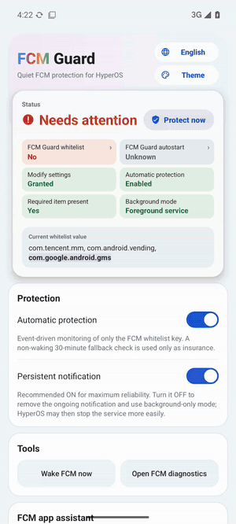
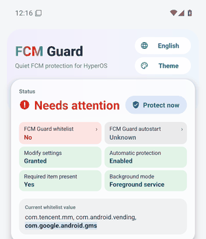
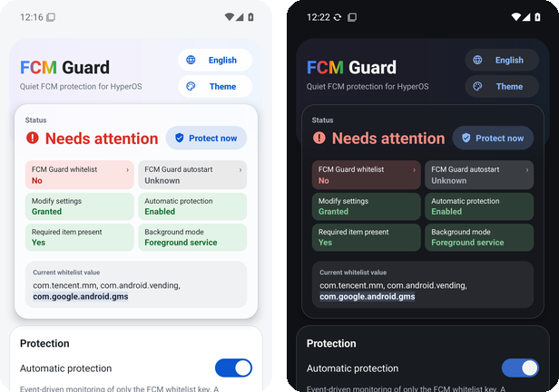

FCM Guard 2.0 — a redesigned app on the same low-power guard.
FCM Guard 2.0：界面全面重做，后台守护机制不变、依旧低功耗。

> **Upgrading from 1.5.x: uninstall the old version first.** 2.0 is signed with a new release key, so it cannot install over 1.5.x. The Google Play services whitelist entry stays, but uninstalling resets FCM Guard's own permission and HyperOS settings. After installing, redo the README's Quick setup: grant Modify system settings, turn on Automatic protection, and set FCM Guard's Autostart and No restrictions battery policy.
> **从 1.5.x 升级：请先卸载旧版。** 2.0 使用新的签名密钥，无法覆盖安装 1.5.x。白名单里的 Google Play 服务不受影响，但卸载会重置 FCM Guard 自身的权限和 HyperOS 设置。安装后请按 README 的“快速使用”重新设置：授予“修改系统设置”，打开“自动保护”，并给 FCM Guard 开启自启动、省电策略设为“无限制”。

  
  
  

**New / 新功能**
- **9 themes with live preview:** the Theme capsule opens a panel of large previews, and the page recolours behind it.
  9 套主题，点“主题”打开大图预览面板，背后页面实时换色。
- **Status card:**
  - The card docks as you scroll.
  - Tiles stack and can be flicked through.
  - A red tile opens the setting that fixes it.
  - **Protect now** sits next to the status.

  状态卡吸顶，小卡堆叠并可连续甩动切换，红色小卡点一下直达对应设置，“立即守护”就在状态右侧。
- **Self-check:** warns when FCM Guard itself is not on the no-restrict whitelist or its Autostart is off.
  自检：FCM Guard 自己不在免限制白名单或自启动被关时会提醒。
- **Glass and transitions:** HyperOS-style frosted glass (system GPU blur, paused in Battery saver). Crossfades when switching theme, light/dark, language or glass.
  毛玻璃（系统 GPU 模糊，省电模式自动暂停）；切换主题、深浅色、语言、毛玻璃时淡入淡出。

**Under the hood / 底层**
- Opening the app no longer makes the guard service re-register its observer and re-run a full check.
  打开 App 不再让守护服务重复注册监听、重跑完整检查。
- The FCM app scan runs off the UI thread. Fewer redundant window and AppOps calls. The release build is R8-optimized.
  FCM 应用扫描移出界面线程；减少多余的窗口与 AppOps 调用；正式包开启 R8 优化。
- The background mechanism is unchanged: it watches the whitelist setting for changes, with a non-waking 30-minute fallback check.
  后台机制不变：监听白名单设置项的变化，外加不唤醒手机的 30 分钟兜底检查。
