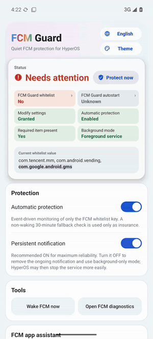
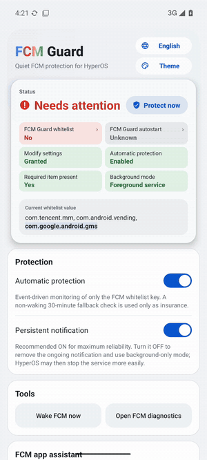
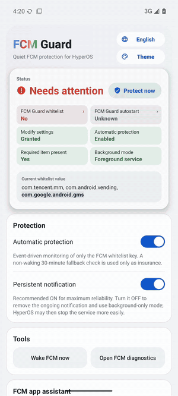

FCM Guard 2.0.1 — smoother switches.
FCM Guard 2.0.1：切换更顺滑。

> **From 2.0.0: install over it directly.** It is signed with the same release key.
> **From 1.5.x: uninstall the old version first** (see the 2.0.0 notes), then redo the README's Quick setup.
> **从 2.0.0 升级：直接覆盖安装**，签名密钥相同。
> **从 1.5.x 升级：请先卸载旧版**（见 2.0.0 说明），安装后按 README 的“快速使用”重新设置。

  
  
  

**Fixes / 修复**
- **System dark-mode switch:** switching light/dark from the system (for example in Control Center) while the app is open now crossfades. Before, it cut straight from light to dark, because Android recreates the page itself for that change.
  在控制中心等系统入口切换深浅色时，App 页面现在也会淡入淡出；之前会直接闪切（这种情况下页面由系统直接重建）。
- **Theme strip snapping:** the strip in the Theme panel now snaps with the app's other animations and follows the system animation speed setting.
  主题面板里的主题条吸附动画与其他动画一致，跟随系统的动画速度设置。

**Docs / 文档**
- The README demos are now real screen recordings (`tools/record_demos.sh`).
  README 中的演示改为真实录屏。
